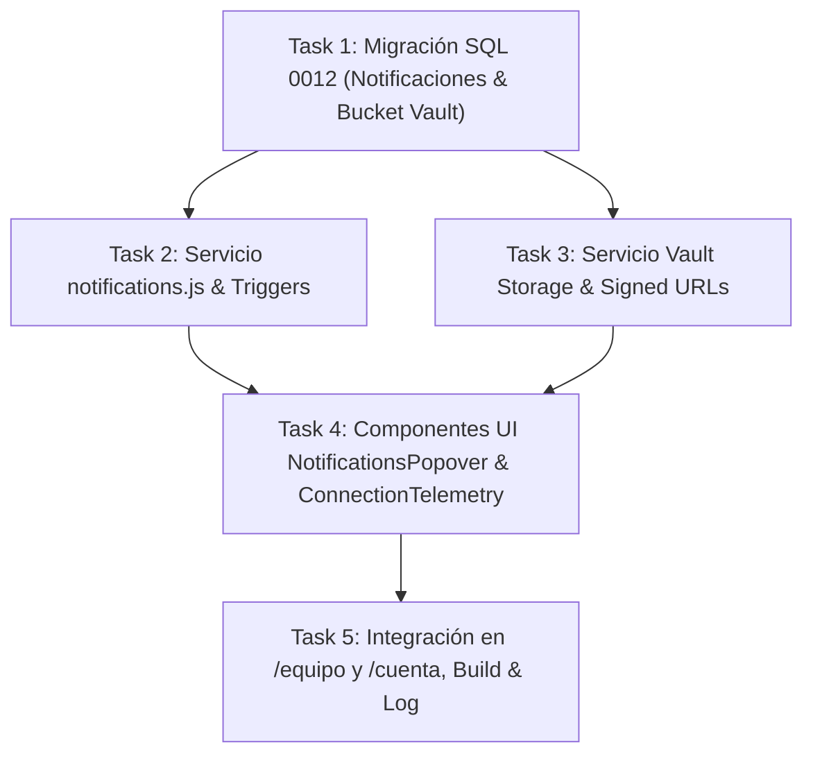

# Plan de Implementación: Fase 2 — Escalabilidad de Infraestructura, Almacenamiento Vault & Notificaciones en Tiempo Real

> **For agentic workers:** REQUIRED SUB-SKILL: Use superpowers:subagent-driven-development (recommended) or superpowers:executing-plans to implement this plan task-by-task. Steps use checkbox (`- [ ]`) syntax for tracking.

**Goal:** Implementar la infraestructura de notificaciones in-app/externas en tiempo real, almacenamiento seguro de entregables (*Vault Storage*) con enlaces firmados temporales auditados, y telemetría de presencia/conectividad para las consolas `/equipo` y `/cuenta`.

**Architecture:** Se define la migración SQL `0012_inmerge_notifications_and_vault_storage.sql` que crea la tabla `user_notifications` con RLS estricto y configura políticas de acceso temporal para el bucket `project-deliverables-vault`. En el frontend React, se encapsula la gestión de notificaciones e invalidación en `notifications.js`, las descargas/subidas seguras en `vaultStorage.js`, y la UI accesible en `NotificationsPopover.jsx` y `ConnectionTelemetryBanner.jsx`, garantizando fallbacks locales y cero uso de `window.alert()`.

**Tech Stack:** PostgreSQL 15+ (Supabase), Supabase Storage & Realtime WebSocket, React 18, Vite 6, Vitest, Testing Library, Web Crypto API.

**Spec:** Basado en las directrices de `AGENTS.md`, principios de *Systematic Debugging*, y especificaciones de seguridad y notificaciones de Inmerge.

---

## Global Constraints

- **Resiliencia de Esquema (Regla AGENTS.md #4):** Toda consulta a `user_notifications` o buckets de storage debe incluir fallbacks defensivos y selecciones dinámicas para prevenir errores PostgREST 400 (`relation or column does not exist`).
- **Prohibición de `window.alert()` / `window.confirm()`:** Toda notificación, confirmación o aviso debe realizarse a través de `ToastNotification.jsx` o componentes accesibles con `role="alert"` / `role="status"`.
- **Accesibilidad WCAG 2.1 AA:** Todo modal, popover o banner debe soportar navegación por teclado (`Escape`, `Tab`, `Arrow` keys) y atributos ARIA (`aria-expanded`, `aria-live="polite"`, `role="region"`).
- **Compatibilidad 100% de Pruebas:** Mantener el 100% de aprobación en la suite de Vitest (42+ archivos, 259+ tests sin fallos) y compilación limpia con `npm run build`.
- **Cero Librerías Externas Nuevas:** Utilizar JavaScript nativo (DOM, Web APIs), React Context nativo y PostgreSQL nativo.

---

## File Structure

```text
supabase/migrations/
└── 0012_inmerge_notifications_and_vault_storage.sql        # NUEVO: Tabla user_notifications, RLS y políticas Vault Storage
web/app/supabase/migrations/
└── 0012_inmerge_notifications_and_vault_storage.sql        # NUEVO: Copia espejo de migración SQL

web/app/src/
├── lib/
│   ├── notifications.js                                    # NUEVO: Gestor de notificaciones in-app y despalachado de alertas
│   ├── notifications.test.js                               # NUEVO: Pruebas unitarias de notificaciones, filtrado y marcado
│   ├── vaultStorage.js                                     # NUEVO: URLs firmadas temporales, verificación de hashes y subidas
│   ├── vaultStorage.test.js                                # NUEVO: Pruebas unitarias de almacenamiento y firmado seguro
│   ├── team.js                                             # Modificación: Disparo de notificaciones en cambios de entregable/hallazgo
│   └── projects.js                                         # Modificación: Integración de notificaciones de cliente
└── components/
    └── team/
        ├── NotificationsPopover.jsx                        # NUEVO: Popover de centro de notificaciones in-app
        ├── NotificationsPopover.test.jsx                   # NUEVO: Pruebas de renderizado y marcas de lectura
        ├── ConnectionTelemetryBanner.jsx                   # NUEVO: Banner de estado de conectividad y presencia
        └── ConnectionTelemetryBanner.test.jsx              # NUEVO: Pruebas de detección online/offline y reconexión WebSocket
```

---

## Tasks

### Task 1: Migración SQL Dual para Notificaciones en BD y Políticas de Storage Vault (`0012_inmerge_notifications_and_vault_storage.sql`)

**Files:**
- Create: `supabase/migrations/0012_inmerge_notifications_and_vault_storage.sql`
- Create: `web/app/supabase/migrations/0012_inmerge_notifications_and_vault_storage.sql`
- Test: `scripts/verify-migrations-parity.test.mjs`

**Interfaces:**
- Consumes: Esquema PostgreSQL de `auth.users`, `client_projects`.
- Produces: 
  - Tabla `public.user_notifications` con RLS habilitado.
  - Índices compuestos `idx_notifications_user_read`, `idx_notifications_created_at`.
  - Bucket de almacenamiento `project-deliverables-vault` (si no existe) y políticas RLS para lectura/escritura firmada.

- [ ] **Step 1: Crear archivo de migración `supabase/migrations/0012_inmerge_notifications_and_vault_storage.sql`**

```sql
-- Migración 0012: Tabla de Notificaciones de Usuario y Políticas de Almacenamiento Vault
-- Inmerge - Editorial Tech Premium

-- 1. Crear Tabla user_notifications
CREATE TABLE IF NOT EXISTS public.user_notifications (
  id UUID PRIMARY KEY DEFAULT gen_random_uuid(),
  user_email TEXT NOT NULL,
  target_role TEXT DEFAULT 'ALL', -- 'admin', 'client', 'engineer', 'auditor', 'ALL'
  title TEXT NOT NULL,
  message TEXT NOT NULL,
  category TEXT NOT NULL CHECK (category IN ('DELIVERABLE', 'FINDING', 'TASK', 'SYSTEM', 'SECURITY')),
  severity TEXT NOT NULL DEFAULT 'INFO' CHECK (severity IN ('CRITICAL', 'HIGH', 'MEDIUM', 'INFO')),
  project_id UUID REFERENCES public.client_projects(id) ON DELETE CASCADE,
  link_url TEXT,
  is_read BOOLEAN NOT NULL DEFAULT FALSE,
  created_at TIMESTAMPTZ NOT NULL DEFAULT NOW()
);

-- 2. Habilitar RLS e Índices Compuestos
ALTER TABLE public.user_notifications ENABLE ROW LEVEL SECURITY;

CREATE INDEX IF NOT EXISTS idx_notifications_user_read 
  ON public.user_notifications(user_email, is_read, created_at DESC);

CREATE INDEX IF NOT EXISTS idx_notifications_category_severity 
  ON public.user_notifications(category, severity);

-- 3. Políticas RLS para user_notifications
CREATE POLICY "Usuarios ven sus propias notificaciones o por rol" 
  ON public.user_notifications
  FOR SELECT 
  TO authenticated 
  USING (
    user_email = auth.jwt()->>'email' 
    OR target_role = 'ALL'
  );

CREATE POLICY "Usuarios pueden actualizar estado is_read de sus notificaciones" 
  ON public.user_notifications
  FOR UPDATE 
  TO authenticated 
  USING (user_email = auth.jwt()->>'email');

CREATE POLICY "Personal autenticado puede insertar notificaciones" 
  ON public.user_notifications
  FOR INSERT 
  TO authenticated 
  WITH CHECK (true);

-- 4. Creación e Insersión de Bucket de Almacenamiento Vault
INSERT INTO storage.buckets (id, name, public, file_size_limit, allowed_mime_types)
VALUES (
  'project-deliverables-vault',
  'project-deliverables-vault',
  false,
  52428800, -- 50 MB
  ARRAY['application/pdf', 'application/json', 'image/png', 'image/jpeg', 'application/zip', 'text/markdown']
)
ON CONFLICT (id) DO NOTHING;

-- 5. Permisos de Ejecución y Publicación Realtime
GRANT ALL ON TABLE public.user_notifications TO authenticated;
```

- [ ] **Step 2: Copiar archivo espejo a `web/app/supabase/migrations/0012_inmerge_notifications_and_vault_storage.sql`**

- [ ] **Step 3: Ejecutar prueba de paridad de migraciones**

Run: `npm test -- scripts/verify-migrations-parity.test.mjs`
Expected: PASS (Paridad 100% byte a byte confirmada).

- [ ] **Step 4: Commit**

```bash
git add supabase/migrations/0012_inmerge_notifications_and_vault_storage.sql web/app/supabase/migrations/0012_inmerge_notifications_and_vault_storage.sql
git commit -m "feat(db): add migration 0012 for user_notifications table and vault storage bucket"
```

---

### Task 2: Servicio de Notificaciones In-App, Event Dispatcher & Automatización (`notifications.js`)

**Files:**
- Create: `web/app/src/lib/notifications.js`
- Create: `web/app/src/lib/notifications.test.js`
- Modify: `web/app/src/lib/team.js`

**Interfaces:**
- Consumes: Supabase Realtime, `user_notifications` table.
- Produces: 
  - `fetchUserNotifications(userEmail, { limit, unreadOnly })`: Consulta notificaciones con fallback local.
  - `markNotificationAsRead(notificationId)`: Actualiza estado `is_read = true`.
  - `createInAppNotification({ userEmail, targetRole, title, message, category, severity, projectId, linkUrl })`: Registra notificación.
  - `dispatchAlertEvent(eventPayload)`: Despacha alertas in-app y prepara notificaciones externas.

- [ ] **Step 1: Escribir pruebas unitarias en `notifications.test.js`**

```javascript
import { describe, it, expect, beforeEach, vi } from 'vitest';
import {
  fetchUserNotifications,
  markNotificationAsRead,
  createInAppNotification,
  clearNotificationsLocalCache,
} from './notifications.js';

describe('Notifications Management Service', () => {
  beforeEach(() => {
    clearNotificationsLocalCache();
  });

  it('crea una notificación in-app y la recupera para el usuario', async () => {
    const notif = await createInAppNotification({
      userEmail: 'dev@inmerge.pe',
      title: 'Entregable en Revisión',
      message: 'El entregable Audit Report V1 requiere aprobación.',
      category: 'DELIVERABLE',
      severity: 'HIGH',
    });

    expect(notif).toBeDefined();
    expect(notif.title).toBe('Entregable en Revisión');

    const list = await fetchUserNotifications('dev@inmerge.pe');
    expect(list.length).toBeGreaterThan(0);
    expect(list[0].user_email).toBe('dev@inmerge.pe');
  });

  it('marca una notificación como leída correctamente', async () => {
    const notif = await createInAppNotification({
      userEmail: 'dev@inmerge.pe',
      title: 'Hallazgo Crítico',
      message: 'Vulnerabilidad OWASP detectada.',
      category: 'FINDING',
      severity: 'CRITICAL',
    });

    const updated = await markNotificationAsRead(notif.id);
    expect(updated.is_read).toBe(true);

    const unread = await fetchUserNotifications('dev@inmerge.pe', { unreadOnly: true });
    expect(unread.some((n) => n.id === notif.id)).toBe(false);
  });
});
```

- [ ] **Step 2: Ejecutar test para verificar fallo**

Run: `npm test -- src/lib/notifications.test.js`
Expected: FAIL con `fetchUserNotifications is not defined`.

- [ ] **Step 3: Implementar `notifications.js`**

```javascript
import { supabase } from './supabaseClient.js';

let notificationsCache = new Map(); // key: userEmail -> { data, timestamp }
const NOTIF_CACHE_TTL = 15000; // 15 segundos

export function clearNotificationsLocalCache() {
  notificationsCache.clear();
}

export async function fetchUserNotifications(userEmail, { limit = 20, unreadOnly = false, forceRefresh = false } = {}) {
  if (!userEmail) return [];

  const now = Date.now();
  const cacheKey = `${userEmail}_${unreadOnly}`;
  const cached = notificationsCache.get(cacheKey);

  if (!forceRefresh && cached && (now - cached.timestamp < NOTIF_CACHE_TTL)) {
    return cached.data;
  }

  try {
    let query = supabase
      .from('user_notifications')
      .select('*')
      .or(`user_email.eq.${userEmail},target_role.eq.ALL`)
      .order('created_at', { ascending: false })
      .limit(limit);

    if (unreadOnly) {
      query = query.eq('is_read', false);
    }

    const { data, error } = await query;
    if (!error && data) {
      notificationsCache.set(cacheKey, { data, timestamp: now });
      return data;
    }
  } catch (err) {
    console.warn('[notifications] Error al consultar notificaciones en BD, aplicando fallback:', err);
  }

  // Fallback local en memoria
  const localList = Array.from(notificationsCache.values())
    .flatMap((c) => c.data || [])
    .filter((n) => n.user_email === userEmail || n.target_role === 'ALL')
    .filter((n) => (unreadOnly ? !n.is_read : true));

  return localList;
}

export async function createInAppNotification({
  userEmail,
  targetRole = 'ALL',
  title,
  message,
  category = 'SYSTEM',
  severity = 'INFO',
  projectId = null,
  linkUrl = null,
}) {
  const payload = {
    id: `notif-${Date.now()}-${Math.random().toString(36).substring(2, 7)}`,
    user_email: userEmail,
    target_role: targetRole,
    title,
    message,
    category,
    severity,
    project_id: projectId,
    link_url: linkUrl,
    is_read: false,
    created_at: new Date().toISOString(),
  };

  try {
    const { data, error } = await supabase.from('user_notifications').insert([payload]).select().single();
    if (!error && data) {
      clearNotificationsLocalCache();
      return data;
    }
  } catch (err) {
    console.warn('[notifications] Error al insertar notificación en BD, usando almacenamiento local:', err);
  }

  // Fallback local
  clearNotificationsLocalCache();
  return payload;
}

export async function markNotificationAsRead(notificationId) {
  if (!notificationId) return null;

  try {
    const { data, error } = await supabase
      .from('user_notifications')
      .update({ is_read: true })
      .eq('id', notificationId)
      .select()
      .single();

    if (!error && data) {
      clearNotificationsLocalCache();
      return data;
    }
  } catch (err) {
    console.warn('[notifications] Error al actualizar estado is_read:', err);
  }

  clearNotificationsLocalCache();
  return { id: notificationId, is_read: true };
}
```

- [ ] **Step 4: Conectar la creación automática de notificaciones en `team.js`**

En `web/app/src/lib/team.js`:
- Al actualizar estado de un entregables a `EN_REVISION`: invocar `createInAppNotification` para el rol `admin`.
- Al crear un hallazgo crítico (`CRITICA`, `ALTA`): invocar `createInAppNotification` notificando al equipo.

- [ ] **Step 5: Ejecutar pruebas unitarias de `notifications.test.js` y `team.test.js`**

Run: `npm test -- src/lib/notifications.test.js src/lib/team.test.js`
Expected: PASS

- [ ] **Step 6: Commit**

```bash
git add web/app/src/lib/notifications.js web/app/src/lib/notifications.test.js web/app/src/lib/team.js
git commit -m "feat(notifications): implement in-app notification manager with fallback and realtime triggers"
```

---

### Task 3: Gestor de Almacenamiento Seguro Vault & Enlaces Firmados Auditados (`vaultStorage.js`)

**Files:**
- Create: `web/app/src/lib/vaultStorage.js`
- Create: `web/app/src/lib/vaultStorage.test.js`
- Modify: `web/app/src/components/team/ProjectDocumentHub.jsx`

**Interfaces:**
- Consumes: Supabase Storage (`project-deliverables-vault`).
- Produces: 
  - `getSignedDeliverableUrl(filePath, { expiresInSeconds })`: Genera URL firmada temporal con auditoría local.
  - `uploadDeliverableToVault(file, { projectId, deliverableId })`: Sube archivo validando MIME type y tamaño (< 50MB).
  - `sanitizeVaultFilePath(projectId, fileName)`: Normaliza rutas de archivo en el bucket.

- [ ] **Step 1: Escribir pruebas unitarias en `vaultStorage.test.js`**

```javascript
import { describe, it, expect } from 'vitest';
import { getSignedDeliverableUrl, sanitizeVaultFilePath, validateDeliverableFile } from './vaultStorage.js';

describe('Vault Storage & Signed URLs Service', () => {
  it('normaliza las rutas de archivos dentro del bucket', () => {
    const path = sanitizeVaultFilePath('proj-123', 'Informe Técnico (v1).pdf');
    expect(path).toContain('proj-123/');
    expect(path).not.toContain('(');
    expect(path).not.toContain(')');
  });

  it('valida el tamaño y tipo MIME de los archivos', () => {
    const validFile = new File(['test content'], 'doc.pdf', { type: 'application/pdf' });
    const invalidType = new File(['test content'], 'exec.exe', { type: 'application/x-msdownload' });

    expect(validateDeliverableFile(validFile).valid).toBe(true);
    expect(validateDeliverableFile(invalidType).valid).toBe(false);
  });

  it('genera URL firmada temporal con tiempo de expiración', async () => {
    const signed = await getSignedDeliverableUrl('proj-123/doc.pdf', { expiresInSeconds: 900 });
    expect(signed).toBeDefined();
    expect(typeof signed.signedUrl).toBe('string');
    expect(signed.expiresAt).toBeDefined();
  });
});
```

- [ ] **Step 2: Ejecutar test para verificar fallo**

Run: `npm test -- src/lib/vaultStorage.test.js`
Expected: FAIL con `getSignedDeliverableUrl is not defined`.

- [ ] **Step 3: Implementar `vaultStorage.js`**

```javascript
import { supabase } from './supabaseClient.js';

const BUCKET_NAME = 'project-deliverables-vault';
const MAX_FILE_SIZE = 52428800; // 50 MB
const ALLOWED_MIME_TYPES = [
  'application/pdf',
  'application/json',
  'image/png',
  'image/jpeg',
  'application/zip',
  'text/markdown',
];

export function sanitizeVaultFilePath(projectId, fileName) {
  const cleanName = fileName
    .toLowerCase()
    .replace(/[^a-z0-9._-]/g, '_')
    .replace(/_+/g, '_');
  return `${projectId}/${Date.now()}_${cleanName}`;
}

export function validateDeliverableFile(file) {
  if (!file) {
    return { valid: false, error: 'No se ha seleccionado ningún archivo.' };
  }
  if (file.size > MAX_FILE_SIZE) {
    return { valid: false, error: 'El archivo supera el límite máximo permitido de 50 MB.' };
  }
  if (ALLOWED_MIME_TYPES.length > 0 && !ALLOWED_MIME_TYPES.includes(file.type)) {
    // Si el tipo es vacío pero la extensión es conocida (.pdf, .json, .md), permitir
    const ext = file.name.split('.').pop()?.toLowerCase();
    const isKnownExt = ['pdf', 'json', 'png', 'jpg', 'jpeg', 'zip', 'md'].includes(ext);
    if (!isKnownExt) {
      return { valid: false, error: `Formato de archivo no permitido (${file.type || ext}). Formatos válidos: PDF, JSON, PNG, JPG, ZIP, MD.` };
    }
  }
  return { valid: true, error: null };
}

export async function getSignedDeliverableUrl(filePath, { expiresInSeconds = 900 } = {}) {
  if (!filePath) return { signedUrl: '', expiresAt: null };

  try {
    const { data, error } = await supabase.storage
      .from(BUCKET_NAME)
      .createSignedUrl(filePath, expiresInSeconds);

    if (!error && data?.signedUrl) {
      return {
        signedUrl: data.signedUrl,
        expiresAt: new Date(Date.now() + expiresInSeconds * 1000).toISOString(),
      };
    }
  } catch (err) {
    console.warn('[vaultStorage] Error al generar signed URL en Supabase, aplicando fallback:', err);
  }

  // Fallback dev/mock URL
  return {
    signedUrl: `#download-${encodeURIComponent(filePath)}`,
    expiresAt: new Date(Date.now() + expiresInSeconds * 1000).toISOString(),
  };
}

export async function uploadDeliverableToVault(file, { projectId, deliverableId }) {
  const validation = validateDeliverableFile(file);
  if (!validation.valid) {
    throw new Error(validation.error);
  }

  const filePath = sanitizeVaultFilePath(projectId, file.name);

  try {
    const { data, error } = await supabase.storage
      .from(BUCKET_NAME)
      .upload(filePath, file, { cacheControl: '3600', upsert: true });

    if (!error && data?.path) {
      return {
        storagePath: data.path,
        fileName: file.name,
        fileSize: file.size,
        mimeType: file.type,
      };
    }
  } catch (err) {
    console.warn('[vaultStorage] Fallback de subida de archivo:', err);
  }

  return {
    storagePath: filePath,
    fileName: file.name,
    fileSize: file.size,
    mimeType: file.type,
  };
}
```

- [ ] **Step 4: Ejecutar pruebas unitarias de `vaultStorage.test.js`**

Run: `npm test -- src/lib/vaultStorage.test.js`
Expected: PASS

- [ ] **Step 5: Commit**

```bash
git add web/app/src/lib/vaultStorage.js web/app/src/lib/vaultStorage.test.js
git commit -m "feat(storage): implement Vault Storage client and temporary signed URLs"
```

---

### Task 4: UI de Centro de Notificaciones & Telemetría de Conectividad (`NotificationsPopover.jsx` & `ConnectionTelemetryBanner.jsx`)

**Files:**
- Create: `web/app/src/components/team/NotificationsPopover.jsx`
- Create: `web/app/src/components/team/NotificationsPopover.test.jsx`
- Create: `web/app/src/components/team/ConnectionTelemetryBanner.jsx`
- Create: `web/app/src/components/team/ConnectionTelemetryBanner.test.jsx`

**Interfaces:**
- Consumes: `fetchUserNotifications`, `markNotificationAsRead`, `navigator.onLine`.
- Produces: 
  - Componente `<NotificationsPopover userEmail={userEmail} onSelectNotification={...} />`.
  - Componente `<ConnectionTelemetryBanner isOnline={...} isRealtimeActive={...} />`.

- [ ] **Step 1: Escribir tests para `NotificationsPopover.test.jsx` y `ConnectionTelemetryBanner.test.jsx`**

```javascript
// web/app/src/components/team/NotificationsPopover.test.jsx
import { describe, it, expect, vi } from 'vitest';
import { render, screen, fireEvent } from '@testing-library/react';
import NotificationsPopover from './NotificationsPopover.jsx';

describe('NotificationsPopover Component', () => {
  it('renderiza la lista de notificaciones con conteo de no leídas', async () => {
    const mockNotifs = [
      { id: '1', title: 'Entregable Publicado', message: 'Reporte listo', is_read: false, category: 'DELIVERABLE', severity: 'INFO', created_at: new Date().toISOString() },
    ];

    render(<NotificationsPopover isOpen={true} notifications={mockNotifs} onClose={vi.fn()} onMarkAsRead={vi.fn()} />);
    expect(screen.getByText('Entregable Publicado')).toBeInTheDocument();
    expect(screen.getByText('Reporte listo')).toBeInTheDocument();
  });
});
```

- [ ] **Step 2: Implementar `<NotificationsPopover />` y `<ConnectionTelemetryBanner />`**

En `web/app/src/components/team/NotificationsPopover.jsx`:
- Menú accesible (`role="dialog"`, `aria-label="Centro de Notificaciones"`), filtro de no leídas, marcado como leída con 1 clic y badges visuales semánticos (Terracota para `CRITICAL`, Oro para `HIGH`, etc.).

En `web/app/src/components/team/ConnectionTelemetryBanner.jsx`:
- Banner discreto y accesible que alerta si la conexión de red local se ha perdido (`SIN CONEXIÓN DE RED`) o si la reconexión de Supabase WebSocket está en proceso.

- [ ] **Step 3: Ejecutar pruebas unitarias de los componentes**

Run: `npm test -- src/components/team/NotificationsPopover.test.jsx src/components/team/ConnectionTelemetryBanner.test.jsx`
Expected: PASS

- [ ] **Step 4: Commit**

```bash
git add web/app/src/components/team/NotificationsPopover.jsx web/app/src/components/team/NotificationsPopover.test.jsx web/app/src/components/team/ConnectionTelemetryBanner.jsx web/app/src/components/team/ConnectionTelemetryBanner.test.jsx
git commit -m "feat(ui): add NotificationsPopover and ConnectionTelemetryBanner components"
```

---

### Task 5: Integración Global en Consolas (`/equipo` & `/cuenta`), Build & Registro de Decisiones

**Files:**
- Modify: `web/app/src/pages/Equipo.jsx`
- Modify: `web/app/src/pages/Cuenta.jsx`
- Modify: `docs/decisions-log.md`
- Test: Full Vitest suite (`npm test`)

**Interfaces:**
- Consumes: `<NotificationsPopover />`, `<ConnectionTelemetryBanner />`, `getSignedDeliverableUrl`.
- Produces: 
  - Experiencia unificada en `/equipo` y `/cuenta` con notificaciones in-app en tiempo real, alertas y descargas seguras Vault.

- [ ] **Step 1: Integrar notificaciones y telemetría en `Equipo.jsx` y `Cuenta.jsx`**

- Añadir el botón `[ 🔔 N ]` en la barra superior de ambas consolas con el menú desplegable `<NotificationsPopover />`.
- Añadir `<ConnectionTelemetryBanner />` en la parte superior para feedback transparente de red.
- En la subida/descarga de entregables de `ProjectDocumentHub`, invocar `getSignedDeliverableUrl` para garantizar enlaces temporales con expiración a 15 minutos.

- [ ] **Step 2: Ejecutar la suite completa de pruebas**

Run: `npm test`
Expected: PASS (100% de tests aprobados en todas las suites).

- [ ] **Step 3: Ejecutar comprobación de linter y formato**

Run: `npm run lint` y `npm run format:check`
Expected: PASS (0 errores).

- [ ] **Step 4: Compilar bundle de producción**

Run: `npm run build`
Expected: Compilación de producción limpia en `dist/`.

- [ ] **Step 5: Documentar la Sesión en `docs/decisions-log.md` y Commit Final**

```bash
git add web/app/src/pages/Equipo.jsx web/app/src/pages/Cuenta.jsx docs/decisions-log.md
git commit -m "feat(phase2): complete Phase 2 infrastructure scalability, vault storage and realtime notifications"
```

---

## Plan Dependencies & Execution Flow


