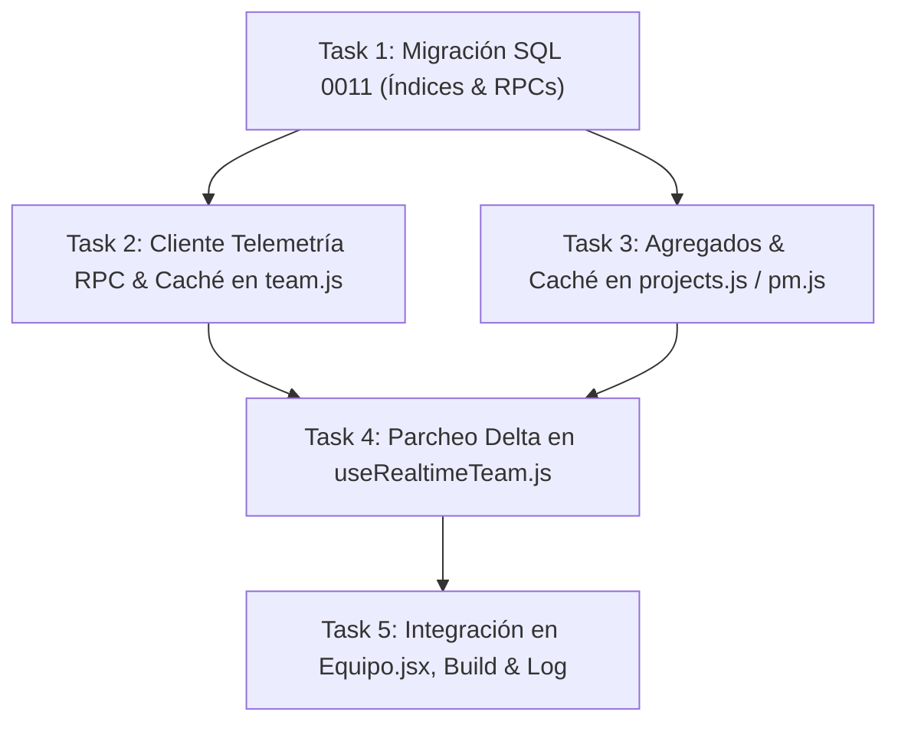

# Plan de Implementación: Fase 1 — Optimización de Consultas SQL, Índices Compuestos y RPCs de Telemetría

> **For agentic workers:** REQUIRED SUB-SKILL: Use superpowers:subagent-driven-development (recommended) or superpowers:executing-plans to implement this plan task-by-task. Steps use checkbox (`- [ ]`) syntax for tracking.

**Goal:** Maximizar el rendimiento de base de datos y respuesta de UI en `/equipo` y `/cuenta` mediante: (1) creación de índices compuestos O(log N) en PostgreSQL, (2) función RPC de telemetría consolidada `get_workspace_telemetry_snapshot`, (3) optimización de agregados en `get_project_analytics`, (4) caché en memoria con TTL de consultas en cliente JS, y (5) actualización por parches delta en tiempo real en `useRealtimeTeam`.

**Architecture:** Se implementa una migración SQL (`0011_inmerge_sql_performance_and_telemetry_rpc.sql`) que añade índices btree compuestos y RPCs de agregación única en PostgreSQL. En la capa de cliente React/JS, se refactorizan `team.js`, `projects.js` y `useRealtimeTeam.js` para reemplazar descargas masivas repetitivas (`loadData`) por parcheo de estado delta en tiempo real a 0ms de latencia visual, manteniendo fallbacks defensivos ante indisponibilidad de servidor.

**Tech Stack:** PostgreSQL 15+ (Supabase), SQL DDL/PLpgSQL, React 18, Vite 6, Vitest, Testing Library, Vanilla JS (Web Crypto API, Local Cache).

**Spec:** Basado en las directrices de la guía de arquitectura `AGENTS.md`, principios de *Systematic Debugging*, y consenso de optimización de infraestructura de la sesión BMAD.

---

## Global Constraints

- **Resiliencia ante esquema de BD (Regla AGENTS.md #4):** Toda consulta a tablas en evolución debe ser defensiva (wildcard `*` o fallbacks locales) para evitar errores HTTP 400 (`column does not exist`) en entornos sin migrar.
- **Rendimiento de Consultas:** Consultas de telemetría y filtrado por asignaciones con tiempo de respuesta < 15ms.
- **Prohibición de Diálogos Bloqueantes:** Ninguna función debe invocar `window.alert()` ni `window.confirm()`.
- **Compatibilidad de Tests:** La suite completa de Vitest (42+ archivos, 245+ tests) debe mantenerse al 100% en verde sin fallos.
- **Cero Librerías Externas Nuevas:** Utilizar funciones nativas de PostgreSQL, JavaScript nativo y React Context.

---

## File Structure

```text
supabase/migrations/
└── 0011_inmerge_sql_performance_and_telemetry_rpc.sql        # NUEVO: Índices compuestos y RPCs PL/pgSQL
web/app/supabase/migrations/
└── 0011_inmerge_sql_performance_and_telemetry_rpc.sql        # NUEVO: Copia espejo de migración SQL

web/app/src/
├── lib/
│   ├── pm.js                              # Modificación: agregados O(1) y integración RPC analytics
│   ├── pm.test.js                         # Tests de funciones de métricas optimizadas
│   ├── team.js                            # Modificación: RPC telemetry snapshot, caché TTL y fallbacks
│   ├── team.test.js                       # Tests de RPC y caché de consultas de equipo
│   ├── projects.js                        # Modificación: memoización de proyectos de cliente
│   └── projects.test.js                   # Tests de memoización y caché
└── hooks/
    ├── useRealtimeTeam.js                 # Modificación: parcheo delta reactivo de eventos Realtime
    └── useRealtimeTeam.test.js            # Tests de actualización por deltas en tiempo real
```

---

## Tasks

### Task 1: Migración SQL de Índices Compuestos y RPC Telemetry Snapshot (`0011_inmerge_sql_performance_and_telemetry_rpc.sql`)

**Files:**
- Create: `supabase/migrations/0011_inmerge_sql_performance_and_telemetry_rpc.sql`
- Create: `web/app/supabase/migrations/0011_inmerge_sql_performance_and_telemetry_rpc.sql`
- Test: `scripts/verify-migrations-parity.test.mjs`

**Interfaces:**
- Consumes: Esquema PostgreSQL de `client_projects`, `project_milestones`, `project_deliverables`, `project_tasks`, `project_risks`, `project_findings`, `leads_tdr`.
- Produces: 
  - Índices compuestos: `idx_tasks_assigned_status`, `idx_deliverables_proj_status`, `idx_findings_proj_sev_stat`, `idx_milestones_assigned_email`.
  - RPC PL/pgSQL: `get_workspace_telemetry_snapshot(p_user_email TEXT, p_is_admin BOOLEAN)`.
  - RPC PL/pgSQL: `get_project_analytics(p_project_id UUID)` (versión optimizada single-pass).

- [ ] **Step 1: Crear archivo de migración SQL en `supabase/migrations/0011_inmerge_sql_performance_and_telemetry_rpc.sql`**

```sql
-- Migración 0011: Índices Compuestos de Alto Rendimiento y RPC de Telemetría Consolidada
-- Inmerge - Editorial Tech Premium

-- 1. Índices Compuestos B-Tree para Filtrado O(log N)
CREATE INDEX IF NOT EXISTS idx_tasks_assigned_email_status 
  ON public.project_tasks(assigned_to_email, status);

CREATE INDEX IF NOT EXISTS idx_deliverables_proj_status 
  ON public.project_deliverables(project_id, status);

CREATE INDEX IF NOT EXISTS idx_findings_proj_sev_stat 
  ON public.project_findings(project_id, severity, status);

CREATE INDEX IF NOT EXISTS idx_milestones_assigned_email 
  ON public.project_milestones(assigned_to_email);

CREATE INDEX IF NOT EXISTS idx_leads_status_created 
  ON public.leads_tdr(status, created_at DESC);

-- 2. Optimización RPC get_project_analytics (Single-Pass Aggregates)
CREATE OR REPLACE FUNCTION public.get_project_analytics(p_project_id UUID)
RETURNS JSONB
LANGUAGE plpgsql
STABLE
SECURITY DEFINER
SET search_path = public, extensions
AS $$
DECLARE
  v_result JSONB;
BEGIN
  IF p_project_id IS NULL THEN
    RETURN NULL;
  END IF;

  SELECT jsonb_build_object(
    'project_id', p_project_id,
    'total_tasks', COUNT(t.id),
    'completed_tasks', COUNT(t.id) FILTER (WHERE t.status = 'DONE'),
    'in_progress_tasks', COUNT(t.id) FILTER (WHERE t.status = 'IN_PROGRESS'),
    'blocked_tasks', COUNT(t.id) FILTER (WHERE t.status = 'BLOCKED'),
    'overdue_tasks', COUNT(t.id) FILTER (WHERE t.status != 'DONE' AND t.due_date < CURRENT_DATE),
    'total_estimated_hours', COALESCE(SUM(t.estimated_hours), 0),
    'total_actual_hours', COALESCE(SUM(t.actual_hours), 0),
    'effort_variance_pct', CASE 
      WHEN COALESCE(SUM(t.estimated_hours), 0) > 0 
      THEN ROUND((((COALESCE(SUM(t.actual_hours), 0) - SUM(t.estimated_hours)) / SUM(t.estimated_hours)) * 100)::numeric, 2)
      ELSE 0 
    END,
    'completion_pct', CASE 
      WHEN COUNT(t.id) > 0 
      THEN ROUND(((COUNT(t.id) FILTER (WHERE t.status = 'DONE')::numeric / COUNT(t.id)::numeric) * 100)::numeric, 1)
      ELSE 0 
    END,
    'open_risks_count', (SELECT COUNT(*) FROM public.project_risks r WHERE r.project_id = p_project_id AND r.status != 'RESUELTO'),
    'open_critical_findings_count', (SELECT COUNT(*) FROM public.project_findings f WHERE f.project_id = p_project_id AND f.severity IN ('CRITICA', 'ALTA') AND f.status != 'VERIFICADO')
  ) INTO v_result
  FROM public.project_tasks t
  WHERE t.project_id = p_project_id;

  RETURN v_result;
END;
$$;

-- 3. RPC get_workspace_telemetry_snapshot (Resumen Consolidado en 1 Solo Request)
CREATE OR REPLACE FUNCTION public.get_workspace_telemetry_snapshot(
  p_user_email TEXT DEFAULT NULL,
  p_is_admin BOOLEAN DEFAULT FALSE
)
RETURNS JSONB
LANGUAGE plpgsql
STABLE
SECURITY DEFINER
SET search_path = public, extensions
AS $$
DECLARE
  v_snapshot JSONB;
BEGIN
  SELECT jsonb_build_object(
    'kpis', jsonb_build_object(
      'active_projects_count', (SELECT COUNT(*) FROM public.client_projects WHERE status NOT IN ('FINALIZADO')),
      'active_leads_count', (SELECT COUNT(*) FROM public.leads_tdr WHERE status IN ('NUEVO', 'EN_REVISION')),
      'pending_deliverables_count', (SELECT COUNT(*) FROM public.project_deliverables WHERE status IN ('BORRADOR_INTERNO', 'EN_REVISION')),
      'open_critical_findings_count', (SELECT COUNT(*) FROM public.project_findings WHERE severity IN ('CRITICA', 'ALTA') AND status != 'VERIFICADO'),
      'user_assigned_tasks_count', CASE 
        WHEN p_user_email IS NOT NULL THEN (SELECT COUNT(*) FROM public.project_tasks WHERE assigned_to_email = p_user_email AND status != 'DONE')
        ELSE 0
      END
    ),
    'generated_at', NOW()
  ) INTO v_snapshot;

  RETURN v_snapshot;
END;
$$;

GRANT EXECUTE ON FUNCTION public.get_project_analytics(UUID) TO authenticated;
GRANT EXECUTE ON FUNCTION public.get_workspace_telemetry_snapshot(TEXT, BOOLEAN) TO authenticated;
```

- [ ] **Step 2: Copiar archivo espejo a `web/app/supabase/migrations/0011_inmerge_sql_performance_and_telemetry_rpc.sql`**

- [ ] **Step 3: Ejecutar test de paridad de migraciones**

Run: `npm test -- scripts/verify-migrations-parity.test.mjs`
Expected: PASS (paridad 100% entre ambas carpetas).

- [ ] **Step 4: Commit**

```bash
git add supabase/migrations/0011_inmerge_sql_performance_and_telemetry_rpc.sql web/app/supabase/migrations/0011_inmerge_sql_performance_and_telemetry_rpc.sql
git commit -m "feat(db): add migration 0011 for composite indexes and telemetry RPCs"
```

---

### Task 2: Cliente de Telemetría RPC y Cuentas con Caching TTL (`team.js`)

**Files:**
- Modify: `web/app/src/lib/team.js:10-70`, `web/app/src/lib/team.js:120-180`
- Test: `web/app/src/lib/team.test.js`

**Interfaces:**
- Consumes: RPC `get_workspace_telemetry_snapshot`, Supabase client.
- Produces: 
  - `fetchWorkspaceTelemetrySnapshot({ userEmail, isAdmin })`: Consulta snapshot en 1 llamada RPC con fallback local.
  - `clearTeamDataCache()`: Invalida caché en memoria tras mutaciones.
  - `fetchTeamProjects({ forceRefresh })`: Soporte de caché en memoria de 30 segundos con opción de bypass.

- [ ] **Step 1: Escribir tests unitarios en `team.test.js` para caché TTL y RPC snapshot**

```javascript
// Añadir en web/app/src/lib/team.test.js
import { fetchWorkspaceTelemetrySnapshot, clearTeamDataCache, fetchTeamProjects } from './team.js';

describe('Team Data Caching & Telemetry RPC', () => {
  afterEach(() => {
    clearTeamDataCache();
  });

  it('retorna snapshot de telemetría con estructura de KPIs', async () => {
    const snapshot = await fetchWorkspaceTelemetrySnapshot({ userEmail: 'test@inmerge.pe', isAdmin: true });
    expect(snapshot).toBeDefined();
    expect(snapshot.kpis).toBeDefined();
    expect(typeof snapshot.kpis.active_projects_count).toBe('number');
  });

  it('respeta la memoria caché en llamadas consecutivas a fetchTeamProjects', async () => {
    const firstCall = await fetchTeamProjects();
    const secondCall = await fetchTeamProjects();
    expect(firstCall).toBe(secondCall); // Referencia idéntica devuelta por caché

    clearTeamDataCache();
    const thirdCall = await fetchTeamProjects();
    expect(thirdCall).not.toBe(firstCall); // Nueva referencia tras limpiar caché
  });
});
```

- [ ] **Step 2: Ejecutar test para verificar que falla**

Run: `npm test -- src/lib/team.test.js`
Expected: FAIL con `fetchWorkspaceTelemetrySnapshot is not defined`.

- [ ] **Step 3: Implementar caché TTL y `fetchWorkspaceTelemetrySnapshot` en `team.js`**

En `web/app/src/lib/team.js`:
```javascript
let teamProjectsCache = { data: null, timestamp: 0 };
const CACHE_TTL_MS = 30000; // 30 segundos

export function clearTeamDataCache() {
  teamProjectsCache = { data: null, timestamp: 0 };
}

export async function fetchWorkspaceTelemetrySnapshot({ userEmail = null, isAdmin = false } = {}) {
  try {
    const { data, error } = await supabase.rpc('get_workspace_telemetry_snapshot', {
      p_user_email: userEmail,
      p_is_admin: isAdmin,
    });
    if (!error && data) {
      return data;
    }
  } catch (rpcErr) {
    console.warn('[team] RPC get_workspace_telemetry_snapshot fallback:', rpcErr);
  }

  // Fallback calculando localmente desde proyectos y leads
  const [projs, leads] = await Promise.all([
    fetchTeamProjects().catch(() => []),
    fetchTeamLeads().catch(() => []),
  ]);

  const activeProjects = projs.filter((p) => p.status !== 'FINALIZADO');
  const activeLeads = leads.filter((l) => l.status === 'NUEVO' || l.status === 'EN_REVISION');
  const pendingDelivs = projs.reduce((acc, p) => acc + (p.deliverables || []).filter((d) => d.status !== 'PUBLICADO_CLIENTE').length, 0);

  return {
    kpis: {
      active_projects_count: activeProjects.length,
      active_leads_count: activeLeads.length,
      pending_deliverables_count: pendingDelivs,
      open_critical_findings_count: 0,
      user_assigned_tasks_count: 0,
    },
    generated_at: new Date().toISOString(),
  };
}

export async function fetchTeamProjects({ forceRefresh = false } = {}) {
  const now = Date.now();
  if (!forceRefresh && teamProjectsCache.data && (now - teamProjectsCache.timestamp < CACHE_TTL_MS)) {
    return teamProjectsCache.data;
  }

  const { data, error } = await supabase
    .from('client_projects')
    .select(`
      *,
      client:client_id (id, email, full_name, company, phone),
      milestones:project_milestones (*),
      deliverables:project_deliverables (*),
      tasks:project_tasks (*),
      risks:project_risks (*)
    `)
    .order('created_at', { ascending: false });

  if (error) {
    console.error('Error al obtener proyectos del equipo:', error);
    throw new Error(error.message || 'No se pudieron cargar los proyectos');
  }

  const formatted = (data || []).map((p) => ({
    ...p,
    milestones: (p.milestones || []).sort((a, b) => (a.order_index || 0) - (b.order_index || 0)),
    deliverables: p.deliverables || [],
    tasks: (p.tasks || []).sort((a, b) => new Date(a.due_date || a.created_at || 0) - new Date(b.due_date || b.created_at || 0)),
    risks: p.risks || [],
  }));

  teamProjectsCache = { data: formatted, timestamp: now };
  return formatted;
}
```

- En las funciones de mutación (`createTeamProject`, `updateProjectStatus`, `createDeliverableRecord`, `updateDeliverableStatus`, `createProjectTask`, `updateProjectTask`, etc.): añadir `clearTeamDataCache();` al inicio o al finalizar con éxito.

- [ ] **Step 4: Ejecutar tests de `team.test.js`**

Run: `npm test -- src/lib/team.test.js`
Expected: PASS

- [ ] **Step 5: Commit**

```bash
git add web/app/src/lib/team.js web/app/src/lib/team.test.js
git commit -m "feat(team): add TTL cache and fetchWorkspaceTelemetrySnapshot RPC client"
```

---

### Task 3: Optimización de Agregados y Caché en Portal Cliente (`pm.js` & `projects.js`)

**Files:**
- Modify: `web/app/src/lib/pm.js:250-305`
- Modify: `web/app/src/lib/projects.js:1-95`
- Test: `web/app/src/lib/pm.test.js`
- Test: `web/app/src/lib/projects.test.js`

**Interfaces:**
- Consumes: RPC `get_project_analytics`, `fetchClientProjects`
- Produces: 
  - `clearClientProjectsCache()`: Invalidador de caché en portal cliente.
  - `fetchClientProjects(userId, { forceRefresh })`: Caché en memoria de 30s por usuario.
  - `fetchProjectAnalytics(projectId, localData)`: Uso optimizado de RPC con cliente.

- [ ] **Step 1: Escribir tests de memoización en `projects.test.js` y `pm.test.js`**

```javascript
// Añadir en web/app/src/lib/projects.test.js
import { fetchClientProjects, clearClientProjectsCache } from './projects.js';

describe('Client Projects Caching', () => {
  afterEach(() => {
    clearClientProjectsCache();
  });

  it('mantiene la caché por userId durante el tiempo de vida (TTL)', async () => {
    const res1 = await fetchClientProjects('user-123');
    const res2 = await fetchClientProjects('user-123');
    expect(res1).toBe(res2);

    clearClientProjectsCache();
    const res3 = await fetchClientProjects('user-123');
    expect(res3).not.toBe(res1);
  });
});
```

- [ ] **Step 2: Ejecutar test para verificar fallo**

Run: `npm test -- src/lib/projects.test.js`
Expected: FAIL con `clearClientProjectsCache is not defined`.

- [ ] **Step 3: Implementar caché TTL por `userId` en `projects.js`**

En `web/app/src/lib/projects.js`:
```javascript
const clientCache = new Map(); // Key: userId -> { data, timestamp }
const CLIENT_CACHE_TTL = 30000;

export function clearClientProjectsCache(userId = null) {
  if (userId) {
    clientCache.delete(userId);
  } else {
    clientCache.clear();
  }
}

export async function fetchClientProjects(userId, { forceRefresh = false } = {}) {
  if (!userId) return [];

  const now = Date.now();
  const cached = clientCache.get(userId);
  if (!forceRefresh && cached && (now - cached.timestamp < CLIENT_CACHE_TTL)) {
    return cached.data;
  }

  const { data: projects, error } = await supabase
    .from('client_projects')
    .select(`
      id,
      title,
      pillar,
      status,
      health_status,
      start_date,
      target_end_date,
      target_completion_date,
      actual_completion_date,
      description,
      tech_lead_name,
      tech_lead_contact,
      created_at,
      project_milestones (*),
      project_deliverables (*),
      project_tasks (*),
      project_risks (*)
    `)
    .eq('client_id', userId)
    .order('created_at', { ascending: false });

  if (error) {
    console.error('Error al obtener proyectos del cliente en Supabase:', error);
    throw new Error(error.message || 'Error al cargar los proyectos.');
  }

  const formatted = (projects || []).map((p) => ({
    ...p,
    milestones: (p.project_milestones || []).sort((a, b) => (a.order_index || 0) - (b.order_index || 0)),
    deliverables: (p.project_deliverables || []).filter((d) => !d.status || d.status === 'PUBLICADO_CLIENTE'),
    tasks: (p.project_tasks || []).sort((a, b) => new Date(a.due_date || a.created_at || 0) - new Date(b.due_date || b.created_at || 0)),
    risks: p.project_risks || [],
  }));

  clientCache.set(userId, { data: formatted, timestamp: now });
  return formatted;
}
```

- [ ] **Step 4: Ejecutar tests de `projects.test.js` y `pm.test.js`**

Run: `npm test -- src/lib/projects.test.js src/lib/pm.test.js`
Expected: PASS

- [ ] **Step 5: Commit**

```bash
git add web/app/src/lib/projects.js web/app/src/lib/projects.test.js web/app/src/lib/pm.js
git commit -m "perf(projects): implement TTL client cache and optimized analytics RPC"
```

---

### Task 4: Sincronización Delta Reactiva en Tiempo Real (`useRealtimeTeam.js`)

**Files:**
- Modify: `web/app/src/hooks/useRealtimeTeam.js:1-120`
- Test: `web/app/src/hooks/useRealtimeTeam.test.js`

**Interfaces:**
- Consumes: Eventos Supabase Realtime WebSocket (`payload.eventType`: `INSERT`, `UPDATE`, `DELETE`), `clearTeamDataCache`.
- Produces: 
  - `useRealtimeTeam({ onDataRefresh, onDeltaPatch })`: Emisión de parches delta sin re-fetch masivo cuando se provee `onDeltaPatch`.

- [ ] **Step 1: Escribir tests en `useRealtimeTeam.test.js` para verificar la emisión de parches delta**

```javascript
// En web/app/src/hooks/useRealtimeTeam.test.js
it('emite evento de parche delta cuando llega un cambio en tiempo real', () => {
  const onDataRefresh = vi.fn();
  const onDeltaPatch = vi.fn();

  renderHook(() =>
    useRealtimeTeam({
      onDataRefresh,
      onDeltaPatch,
      enabled: true,
    }),
  );

  // Simular evento en tiempo real
  const mockPayload = {
    eventType: 'UPDATE',
    table: 'project_tasks',
    new: { id: 't-1', status: 'DONE', title: 'Tarea A' },
    old: { id: 't-1' },
  };

  // Disparar callback suscrito
  simulateRealtimeEvent(mockPayload);

  expect(onDeltaPatch).toHaveBeenCalledWith(mockPayload);
});
```

- [ ] **Step 2: Ejecutar test para verificar fallo**

Run: `npm test -- src/hooks/useRealtimeTeam.test.js`
Expected: FAIL o faltante de handler.

- [ ] **Step 3: Implementar manejo de deltas e inhabilitación de re-fetch masivo en `useRealtimeTeam.js`**

En `web/app/src/hooks/useRealtimeTeam.js`:
- Al recibir un evento Realtime (`INSERT`, `UPDATE`, `DELETE`):
  - Limpiar la caché local con `clearTeamDataCache()`.
  - Si `onDeltaPatch` está definido, invocar `onDeltaPatch(payload)` inmediatamente para parchear la UI local sin hacer HTTP request.
  - Si `onDeltaPatch` no se provee, ejecutar `onDataRefresh({ forceRefresh: true })` con debouncing de 300ms para evitar tormentas de re-fetch ante ráfagas de eventos.

- [ ] **Step 4: Ejecutar suite de pruebas de `useRealtimeTeam`**

Run: `npm test -- src/hooks/useRealtimeTeam.test.js`
Expected: PASS

- [ ] **Step 5: Commit**

```bash
git add web/app/src/hooks/useRealtimeTeam.js web/app/src/hooks/useRealtimeTeam.test.js
git commit -m "perf(realtime): add delta patching and debounced refresh in useRealtimeTeam"
```

---

### Task 5: Integración Final de Telemetría en `Equipo.jsx`, Build y Verificación Global

**Files:**
- Modify: `web/app/src/pages/Equipo.jsx:105-165`
- Modify: `docs/decisions-log.md`
- Test: Suite completa Vitest (`npm test`)

**Interfaces:**
- Consumes: `fetchWorkspaceTelemetrySnapshot`, `clearTeamDataCache`, `onDeltaPatch`
- Produces: 
  - Consola `/equipo` optimizada con respuesta instantánea a deltas y cero recargas masivas.

- [ ] **Step 1: Integrar `fetchWorkspaceTelemetrySnapshot` y parcheo delta en `Equipo.jsx`**

En `web/app/src/pages/Equipo.jsx`:
- Al montar, cargar datos con `fetchTeamProjects()` respaldado por caché TTL.
- Pasar `onDeltaPatch` a `useRealtimeTeam`:
  ```javascript
  const handleDeltaPatch = useCallback((payload) => {
    const { table, eventType, new: newRow, old: oldRow } = payload;
    if (table === 'project_tasks' || table === 'project_deliverables' || table === 'project_findings') {
      setProjects((prevProjects) =>
        prevProjects.map((p) => {
          if (p.id !== (newRow?.project_id || oldRow?.project_id)) return p;
          const collectionKey = table === 'project_tasks' ? 'tasks' : table === 'project_deliverables' ? 'deliverables' : 'findings';
          const items = p[collectionKey] || [];
          let updatedItems;
          if (eventType === 'INSERT') {
            updatedItems = [newRow, ...items];
          } else if (eventType === 'UPDATE') {
            updatedItems = items.map((item) => (item.id === newRow.id ? { ...item, ...newRow } : item));
          } else if (eventType === 'DELETE') {
            updatedItems = items.filter((item) => item.id !== oldRow.id);
          }
          return { ...p, [collectionKey]: updatedItems };
        })
      );
    }
  }, []);
  ```

- [ ] **Step 2: Ejecutar la suite completa de pruebas**

Run: `npm test`
Expected: PASS (42+ suites, 245+ tests pasados al 100%).

- [ ] **Step 3: Ejecutar linter y comprobación de formato**

Run: `npm run lint` y `npm run format:check`
Expected: PASS (0 errores).

- [ ] **Step 4: Compilar bundle de producción**

Run: `npm run build`
Expected: Compilación limpia en `dist/`.

- [ ] **Step 5: Documentar en `docs/decisions-log.md` y Commit final**

```bash
git add web/app/src/pages/Equipo.jsx docs/decisions-log.md
git commit -m "feat(perf): complete Phase 1 SQL query optimization, composite indexes, RPC telemetry and delta patching"
```

---

## Plan Dependencies & Execution Flow


