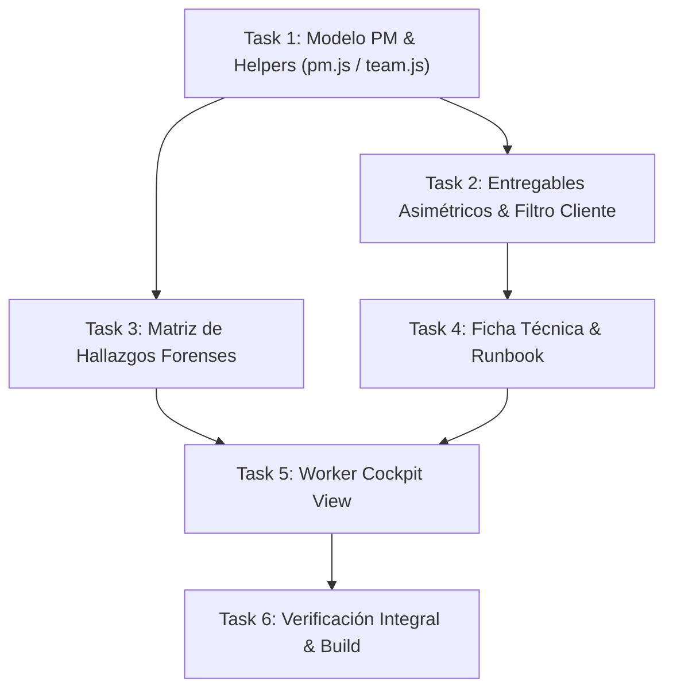

# Plan de Implementación: Cockpit Personal, Auditoría Forense y Gobernanza de Entregables para Trabajadores (/equipo)

> **For agentic workers:** REQUIRED SUB-SKILL: Use superpowers:subagent-driven-development (recommended) or superpowers:executing-plans to implement this plan task-by-task. Steps use checkbox (`- [ ]`) syntax for tracking.

**Goal:** Transformar el panel de operaciones `/equipo` en un entorno de alta productividad para ingenieros y auditores mediante: (1) un flujo de entregables asimétrico con aprobación por roles (`Borrador` → `En Revisión` → `Publicado`), (2) un Cockpit Personal ("Mi Estación de Trabajo") para centralizar tareas y entregables asignados, (3) una Matriz de Hallazgos Forenses de Auditoría estructurada por severidad, y (4) una Ficha Técnica y Runbook de Entorno en cada proyecto.

**Architecture:** Se extiende la capa de datos de Project Management (`pm.js` y `team.js`) incorporando máquinas de estado de entregables y esquemas de hallazgos forenses con persistencia resiliente en Supabase/local. En la UI, se implementa divulgación progresiva con una vista centralizada de Cockpit para roles no-administradores, subpestañas especializadas en `ProjectsManagementView`, y actualización de la paleta de comandos `⌘K`. La vista del cliente (`/cuenta`) se aísla herméticamente para consumir únicamente entregables con estado `PUBLICADO_CLIENTE`.

**Tech Stack:** React 19, Vite 6, Supabase JS Client v2 (RLS & Realtime), Vitest, Testing Library, Vanilla CSS con variables del Sistema de Diseño Inmerge (Space Grotesk, Space Mono, paleta Arena/Tinta/Terracota/Oro).

**Spec:** Basado en la deliberación y consenso de la sesión BMAD Party Mode del 23 de Septiembre de 2026 (Winston, Amelia, Mary, Sally, John) y lineamientos de `AGENTS.md`.

---

## Global Constraints

- **Paleta y Lienzo:** Lienzo Arena mineral (`--bg: #F3EADA`), paneles en Crema (`--cream2: #EBDFC9`), acentos en Terracota (`--terracotta: #A8472B`), Oro (`--gold: #D8A84E`), Tinta (`--ink: #241A12`) y bordes (`--border: #D8CCA8`).
- **Tipografía Editorial:** Títulos, UI y textos en `Space Grotesk`, cifras, telemetría y códigos en `Space Mono`.
- **Prohibición de Diálogos Bloqueantes:** Terminantemente prohibido el uso de `window.alert()` o `window.confirm()`. Toda alerta debe usar `ToastNotification.jsx` o confirmación en dos pasos en el botón.
- **Idioma del Panel:** `/equipo` se mantiene 100% en español técnico para el equipo en Lima.
- **Aislamiento de Clientes:** En `/cuenta`, los clientes NUNCA deben ver ni descargar entregables con estado `BORRADOR_INTERNO` o `EN_REVISION`.
- **Compatibilidad de Tests:** La suite completa de Vitest (40 suites, 210 tests) debe mantenerse al 100% en verde con cero regresiones.
- **Cero Dependencias Externas Nuevas:** Prohibido instalar paquetes de npm; usar utilidades nativas y componentes existentes.

---

## File Structure

```text
web/app/src/
├── lib/
│   ├── pm.js                              # Extensión: constantes y sanitización de entregables y hallazgos
│   ├── pm.test.js                         # Tests de sanitización y cálculos de PM
│   ├── team.js                            # Extensión: CRUD de entregables asimétricos y hallazgos
│   ├── team.test.js                       # Tests de funciones de equipo y estados
│   ├── projects.js                        # Modificación: filtro de entregables publicados para clientes
│   └── projects.test.js                   # Tests de filtro de entregables para clientes
├── components/
│   └── team/
│       ├── ProjectAuditFindings.jsx       # NUEVO: Matriz de hallazgos forenses de auditoría
│       ├── ProjectAuditFindings.test.jsx  # NUEVO: Tests de hallazgos forenses
│       ├── WorkerCockpitView.jsx          # NUEVO: Cockpit personal ("Mi Estación de Trabajo")
│       ├── WorkerCockpitView.test.jsx     # NUEVO: Tests de vista de cockpit personal
│       ├── ProjectDocumentHub.jsx         # Modificación: Ficha técnica y runbook interactivo
│       ├── ProjectDocumentHub.test.jsx    # Tests del hub documental y runbook
│       ├── ProjectsManagementView.jsx     # Modificación: subpestaña de hallazgos y botones asimétricos
│       └── CommandPaletteModal.jsx        # Modificación: accesos directos al Cockpit y Mis Tareas
└── pages/
    ├── Equipo.jsx                         # Modificación: auto-scope ASSIGNED para workers y pestaña Cockpit
    └── Equipo.test.jsx                    # Tests de navegación y permisos en consola
```

---

## Tasks

### Task 1: Extensión del Modelo de Datos PM & Helpers (`pm.js` & `team.js`)

**Files:**
- Modify: `web/app/src/lib/pm.js:40-70`, `web/app/src/lib/pm.js:220-250`
- Modify: `web/app/src/lib/team.js:440-520`
- Test: `web/app/src/lib/pm.test.js`
- Test: `web/app/src/lib/team.test.js`

**Interfaces:**
- Consumes: `supabaseClient.js`
- Produces: 
  - `DELIVERABLE_STATUS_CONFIG`: Objeto con claves `BORRADOR_INTERNO`, `EN_REVISION`, `PUBLICADO_CLIENTE`.
  - `FINDING_SEVERITY_CONFIG`: Objeto con `CRITICA`, `ALTA`, `MEDIA`, `BAJA`, `INFORMATIVA`.
  - `FINDING_CATEGORY_CONFIG`: Objeto con `CORE_WEB_VITALS`, `DATOS_CLOUD`, `SEGURIDAD_OWASP`, `ARQUITECTURA_CLOUD`, `CALIDAD_CODIGO`.
  - `FINDING_STATUS_CONFIG`: Objeto con `DETECTADO`, `EN_CORRECCION`, `VERIFICADO`.
  - `sanitizeFindingPayload(payload)`: Función de validación de hallazgos.
  - `sanitizeDeliverablePayload(payload)`: Función de validación de entregables.
  - `updateDeliverableStatus(deliverableId, newStatus, meta)`: Actualiza estado y audita en `team_activity_logs`.
  - `fetchProjectFindings(projectId)`: Consulta hallazgos por proyecto.
  - `createProjectFinding(payload)`: Inserta un nuevo hallazgo.
  - `updateProjectFinding(findingId, updates)`: Actualiza hallazgo.
  - `deleteProjectFinding(findingId)`: Elimina hallazgo.

- [ ] **Step 1: Escribir tests unitarios en `pm.test.js` para constantes y sanitización de entregables y hallazgos**

```javascript
// Añadir en web/app/src/lib/pm.test.js
import {
  DELIVERABLE_STATUS_CONFIG,
  FINDING_SEVERITY_CONFIG,
  FINDING_CATEGORY_CONFIG,
  FINDING_STATUS_CONFIG,
  sanitizeDeliverablePayload,
  sanitizeFindingPayload,
} from './pm.js';

describe('PM Deliverable & Finding Sanitize Functions', () => {
  it('valida estados de entregables y asigna BORRADOR_INTERNO por defecto si no es válido', () => {
    expect(DELIVERABLE_STATUS_CONFIG.BORRADOR_INTERNO).toBeDefined();
    expect(DELIVERABLE_STATUS_CONFIG.PUBLICADO_CLIENTE).toBeDefined();

    const sanitized = sanitizeDeliverablePayload({
      title: 'Reporte de Auditoría Cloud',
      fileType: 'PDF',
      status: 'INVALID_STATUS',
    });

    expect(sanitized.title).toBe('Reporte de Auditoría Cloud');
    expect(sanitized.status).toBe('BORRADOR_INTERNO');
    expect(sanitized.version).toBe('v1.0');
  });

  it('valida campos obligatorios y sanitiza payload de hallazgo forense', () => {
    expect(() => sanitizeFindingPayload({})).toThrow('El título del hallazgo es obligatorio');

    const sanitized = sanitizeFindingPayload({
      project_id: 'proj-123',
      title: 'Vulnerabilidad CSRF en endpoint de órdenes',
      category: 'SEGURIDAD_OWASP',
      severity: 'CRITICA',
      status: 'DETECTADO',
      finding_code: 'FIND-SEC-01',
      evidence_notes: 'Token no validado en POST /orders',
      recommendation: 'Implementar SameSite y double-submit cookie token.',
    });

    expect(sanitized.title).toBe('Vulnerabilidad CSRF en endpoint de órdenes');
    expect(sanitized.category).toBe('SEGURIDAD_OWASP');
    expect(sanitized.severity).toBe('CRITICA');
    expect(sanitized.finding_code).toBe('FIND-SEC-01');
    expect(sanitized.status).toBe('DETECTADO');
  });
});
```

- [ ] **Step 2: Ejecutar test para verificar que falla**

Run: `npm test -- src/lib/pm.test.js`
Expected: FAIL con `DELIVERABLE_STATUS_CONFIG is not defined` o funciones inexistentes.

- [ ] **Step 3: Implementar constantes y funciones de sanitización en `pm.js`**

En `web/app/src/lib/pm.js`:
```javascript
export const DELIVERABLE_STATUS_CONFIG = {
  BORRADOR_INTERNO: {
    key: 'BORRADOR_INTERNO',
    label: 'Borrador Interno',
    color: 'var(--muted, #7A6B58)',
    bg: 'rgba(122, 107, 88, 0.12)',
    description: 'En elaboración por el auditor o ingeniero. No visible para el cliente.',
  },
  EN_REVISION: {
    key: 'EN_REVISION',
    label: 'En Revisión Lead',
    color: 'var(--gold, #D8A84E)',
    bg: 'rgba(216, 168, 78, 0.15)',
    description: 'Listo para revisión técnica del Tech Lead o Administrador.',
  },
  PUBLICADO_CLIENTE: {
    key: 'PUBLICADO_CLIENTE',
    label: 'Publicado al Cliente',
    color: 'var(--green, #4A9C6A)',
    bg: 'rgba(74, 156, 106, 0.15)',
    description: 'Aprobado y disponible para descarga en el portal del cliente.',
  },
};

export const FINDING_SEVERITY_CONFIG = {
  CRITICA: { key: 'CRITICA', label: 'Crítica', color: 'var(--terracotta, #A8472B)', bg: 'rgba(168, 71, 43, 0.15)', badge: 'CRIT' },
  ALTA: { key: 'ALTA', label: 'Alta', color: 'var(--ochre, #C68A3D)', bg: 'rgba(198, 138, 61, 0.15)', badge: 'HIGH' },
  MEDIA: { key: 'MEDIA', label: 'Media', color: 'var(--gold, #D8A84E)', bg: 'rgba(216, 168, 78, 0.15)', badge: 'MED' },
  BAJA: { key: 'BAJA', label: 'Baja', color: 'var(--muted, #7A6B58)', bg: 'rgba(122, 107, 88, 0.12)', badge: 'LOW' },
  INFORMATIVA: { key: 'INFORMATIVA', label: 'Informativa', color: '#3182CE', bg: 'rgba(49, 130, 206, 0.12)', badge: 'INFO' },
};

export const FINDING_CATEGORY_CONFIG = {
  CORE_WEB_VITALS: { key: 'CORE_WEB_VITALS', label: '01. Core Web Vitals & Web Perf', icon: '⚡' },
  DATOS_CLOUD: { key: 'DATOS_CLOUD', label: '02. Datos & BigQuery / SQL', icon: '📊' },
  SEGURIDAD_OWASP: { key: 'SEGURIDAD_OWASP', label: '03. Seguridad Cloud & OWASP', icon: '🔒' },
  ARQUITECTURA_CLOUD: { key: 'ARQUITECTURA_CLOUD', label: '04. Arquitectura & Infra', icon: '☁️' },
  CALIDAD_CODIGO: { key: 'CALIDAD_CODIGO', label: '05. Calidad de Código & Testing', icon: '🛠️' },
};

export const FINDING_STATUS_CONFIG = {
  DETECTADO: { key: 'DETECTADO', label: 'Detectado', color: 'var(--terracotta, #A8472B)', bg: 'rgba(168, 71, 43, 0.12)' },
  EN_CORRECCION: { key: 'EN_CORRECCION', label: 'En Corrección', color: 'var(--gold, #D8A84E)', bg: 'rgba(216, 168, 78, 0.15)' },
  VERIFICADO: { key: 'VERIFICADO', label: 'Verificado / Resuelto', color: 'var(--green, #4A9C6A)', bg: 'rgba(74, 156, 106, 0.15)' },
};

export function sanitizeDeliverablePayload(payload) {
  if (!payload || typeof payload !== 'object') throw new Error('Payload de entregable inválido');
  if (!payload.title || !String(payload.title).trim()) throw new Error('El título del entregable es obligatorio.');

  const validStatuses = ['BORRADOR_INTERNO', 'EN_REVISION', 'PUBLICADO_CLIENTE'];
  const validFileTypes = ['PDF', 'DASHBOARD_URL', 'REPO', 'DATASET', 'DOCUMENTO', 'XLSX', 'ZIP'];

  return {
    project_id: payload.projectId || payload.project_id,
    milestone_id: payload.milestoneId || payload.milestone_id || null,
    title: String(payload.title).trim(),
    file_type: validFileTypes.includes(payload.fileType || payload.file_type) ? (payload.fileType || payload.file_type) : 'PDF',
    file_path: payload.filePath || payload.file_path || null,
    external_url: payload.externalUrl || payload.external_url || null,
    version: payload.version ? String(payload.version).trim() : 'v1.0',
    notes: payload.notes ? String(payload.notes).trim() : '',
    status: validStatuses.includes(payload.status) ? payload.status : 'BORRADOR_INTERNO',
    author_name: payload.authorName || payload.author_name || null,
    author_email: payload.authorEmail || payload.author_email || null,
  };
}

export function sanitizeFindingPayload(payload) {
  if (!payload || typeof payload !== 'object') throw new Error('Payload de hallazgo inválido');
  if (!payload.title || !String(payload.title).trim()) throw new Error('El título del hallazgo es obligatorio.');

  const validSeverities = ['CRITICA', 'ALTA', 'MEDIA', 'BAJA', 'INFORMATIVA'];
  const validCategories = ['CORE_WEB_VITALS', 'DATOS_CLOUD', 'SEGURIDAD_OWASP', 'ARQUITECTURA_CLOUD', 'CALIDAD_CODIGO'];
  const validStatuses = ['DETECTADO', 'EN_CORRECCION', 'VERIFICADO'];

  return {
    project_id: payload.project_id || payload.projectId,
    milestone_id: payload.milestone_id || payload.milestoneId || null,
    finding_code: payload.finding_code ? String(payload.finding_code).trim().toUpperCase() : `FIND-${Date.now().toString(36).toUpperCase()}`,
    title: String(payload.title).trim(),
    category: validCategories.includes(payload.category) ? payload.category : 'CORE_WEB_VITALS',
    severity: validSeverities.includes(payload.severity) ? payload.severity : 'MEDIA',
    status: validStatuses.includes(payload.status) ? payload.status : 'DETECTADO',
    evidence_notes: payload.evidence_notes ? String(payload.evidence_notes).trim() : null,
    recommendation: payload.recommendation ? String(payload.recommendation).trim() : null,
    created_by_name: payload.created_by_name || null,
    created_by_email: payload.created_by_email || null,
  };
}
```

- [ ] **Step 4: Implementar CRUD en `team.js` para estados de entregables y hallazgos**

En `web/app/src/lib/team.js`:
- Actualizar `createDeliverableRecord` para incluir `status`, `author_name`, `author_email` sanitizados con `sanitizeDeliverablePayload`.
- Agregar función `updateDeliverableStatus(deliverableId, newStatus, { projectId, title, notes } = {})`:
```javascript
export async function updateDeliverableStatus(deliverableId, newStatus, { projectId, title, notes = '' } = {}) {
  if (!deliverableId || !newStatus) throw new Error('ID y nuevo estado son obligatorios.');
  const validStatuses = ['BORRADOR_INTERNO', 'EN_REVISION', 'PUBLICADO_CLIENTE'];
  if (!validStatuses.includes(newStatus)) throw new Error('Estado de entregable inválido.');

  const { data, error } = await supabase
    .from('project_deliverables')
    .update({ status: newStatus, notes: notes || undefined, updated_at: new Date().toISOString() })
    .eq('id', deliverableId)
    .select()
    .single();

  if (error) {
    console.error('Error al actualizar estado de entregable:', error);
    throw new Error(error.message || 'No se pudo actualizar el estado del entregable.');
  }

  logTeamActivity({
    action: 'DELIVERABLE_STATUS_UPDATED',
    entityType: 'deliverable',
    entityId: deliverableId,
    details: { new_status: newStatus, title: title || data?.title, project_id: projectId || data?.project_id },
  });

  return data;
}
```
- Agregar funciones `fetchProjectFindings`, `createProjectFinding`, `updateProjectFinding`, `deleteProjectFinding`:
```javascript
export async function fetchProjectFindings(projectId) {
  if (!projectId) return [];
  const { data, error } = await supabase
    .from('project_findings')
    .select('*')
    .eq('project_id', projectId)
    .order('created_at', { ascending: false });

  if (error) {
    console.warn('project_findings query notice:', error.message);
    return [];
  }
  return data || [];
}

export async function createProjectFinding(payload) {
  const sanitized = sanitizeFindingPayload(payload);
  const { data, error } = await supabase
    .from('project_findings')
    .insert(sanitized)
    .select()
    .single();

  if (error) {
    console.error('Error al registrar hallazgo:', error);
    throw new Error(error.message || 'No se pudo registrar el hallazgo técnico.');
  }

  logTeamActivity({
    action: 'FINDING_CREATED',
    entityType: 'finding',
    entityId: data.id,
    details: { code: sanitized.finding_code, title: sanitized.title, severity: sanitized.severity, project_id: sanitized.project_id },
  });

  return data;
}

export async function updateProjectFinding(findingId, updates) {
  if (!findingId) throw new Error('ID de hallazgo obligatorio.');
  const { data, error } = await supabase
    .from('project_findings')
    .update({ ...updates, updated_at: new Date().toISOString() })
    .eq('id', findingId)
    .select()
    .single();

  if (error) {
    console.error('Error al actualizar hallazgo:', error);
    throw new Error(error.message || 'No se pudo actualizar el hallazgo.');
  }

  logTeamActivity({
    action: 'FINDING_UPDATED',
    entityType: 'finding',
    entityId: findingId,
    details: { updates, title: data?.title, project_id: data?.project_id },
  });

  return data;
}

export async function deleteProjectFinding(findingId) {
  if (!findingId) throw new Error('ID de hallazgo obligatorio.');
  const { error } = await supabase.from('project_findings').delete().eq('id', findingId);
  if (error) {
    console.error('Error al eliminar hallazgo:', error);
    throw new Error(error.message || 'No se pudo eliminar el hallazgo.');
  }
  return true;
}
```

- [ ] **Step 5: Ejecutar suite de pruebas de `pm` y `team`**

Run: `npm test -- src/lib/pm.test.js src/lib/team.test.js`
Expected: PASS

---

### Task 2: Flujo de Entregables Asimétrico & Aislamiento de Clientes

**Files:**
- Modify: `web/app/src/lib/projects.js:36-47`
- Modify: `web/app/src/components/team/ProjectsManagementView.jsx:1100-1280`
- Modify: `web/app/src/pages/Equipo.jsx:400-440`
- Test: `web/app/src/lib/projects.test.js`
- Test: `web/app/src/components/team/ProjectDocumentHub.test.jsx`

**Interfaces:**
- Consumes: `DELIVERABLE_STATUS_CONFIG`, `updateDeliverableStatus`, `createDeliverableRecord`
- Produces: 
  - `fetchClientProjects(userId)`: Filtra entregables excluyendo los que no están en `PUBLICADO_CLIENTE`.
  - Botón de subida disponible para cualquier miembro con rol `isStaff` (`admin`, `engineer`, `auditor`).
  - Acción `[ 🚀 Solicitar Aprobación ]` (para `BORRADOR_INTERNO`).
  - Acción `[ ✓ Publicar al Cliente ]` (exclusivo para `admin`).

- [ ] **Step 1: Escribir test en `projects.test.js` para asegurar que el cliente sólo recibe entregables en `PUBLICADO_CLIENTE`**

```javascript
// Añadir en web/app/src/lib/projects.test.js
it('filtra entregables de cliente para excluir borradores internos o en revisión', async () => {
  // Simular respuesta con entregables en distintos estados
  const mockDeliverables = [
    { id: 'deliv-1', title: 'Dictamen Oficial', status: 'PUBLICADO_CLIENTE' },
    { id: 'deliv-2', title: 'Borrador Técnico', status: 'BORRADOR_INTERNO' },
    { id: 'deliv-3', title: 'Informe en Revisión', status: 'EN_REVISION' },
    { id: 'deliv-4', title: 'Entregable Antiguo Sin Estado' }, // Retrocompatibilidad
  ];
  // Validar lógica de filtrado del portal cliente
  const clientVisible = mockDeliverables.filter(
    (d) => !d.status || d.status === 'PUBLICADO_CLIENTE'
  );
  expect(clientVisible.length).toBe(2);
  expect(clientVisible.map(d => d.id)).toEqual(['deliv-1', 'deliv-4']);
});
```

- [ ] **Step 2: Ejecutar test de proyectos para verificar lógica**

Run: `npm test -- src/lib/projects.test.js`
Expected: PASS

- [ ] **Step 3: Actualizar `web/app/src/lib/projects.js` para filtrar entregables en cliente**

En `web/app/src/lib/projects.js`, en `fetchClientProjects`:
```javascript
    deliverables: (p.project_deliverables || []).filter(
      (d) => !d.status || d.status === 'PUBLICADO_CLIENTE'
    ),
```

- [ ] **Step 4: Habilitar subida para todo el staff y badges de estado en `ProjectsManagementView.jsx` y `ProjectDocumentHub.jsx`**

- Cambiar la condición en `ProjectsManagementView.jsx`:
  Reemplazar `{isAdmin && onUploadDeliverable && (` por:
  `{onUploadDeliverable && (`
- En el modal/drawer de subida: si el usuario no es `isAdmin`, el estado por defecto se fija en `'BORRADOR_INTERNO'`.
- En la tabla de entregables de `ProjectsManagementView.jsx` y `ProjectDocumentHub.jsx`:
  - Renderizar un badge con `DELIVERABLE_STATUS_CONFIG[deliv.status || 'PUBLICADO_CLIENTE']`.
  - Si el estado es `BORRADOR_INTERNO`, mostrar botón `[ 🚀 Solicitar Revisión ]` que llama a `updateDeliverableStatus(deliv.id, 'EN_REVISION')`.
  - Si el usuario es `isAdmin` y el estado no es `PUBLICADO_CLIENTE`, mostrar botón `[ ✓ Aprobar y Publicar al Cliente ]` que llama a `updateDeliverableStatus(deliv.id, 'PUBLICADO_CLIENTE')`.

- [ ] **Step 5: Ejecutar tests de vistas de proyectos**

Run: `npm test -- src/components/team/ProjectDocumentHub.test.jsx src/pages/Equipo.test.jsx`
Expected: PASS

---

### Task 3: Matriz de Hallazgos Forenses de Auditoría (`ProjectAuditFindings.jsx`)

**Files:**
- Create: `web/app/src/components/team/ProjectAuditFindings.jsx`
- Create: `web/app/src/components/team/ProjectAuditFindings.test.jsx`
- Modify: `web/app/src/components/team/ProjectsManagementView.jsx` (añadir subpestaña `PM_FINDINGS`)
- Test: `web/app/src/components/team/ProjectAuditFindings.test.jsx`

**Interfaces:**
- Consumes: `FINDING_SEVERITY_CONFIG`, `FINDING_CATEGORY_CONFIG`, `FINDING_STATUS_CONFIG`, `sanitizeFindingPayload`
- Produces: 
  - `<ProjectAuditFindings />`: Componente accesible con tabla de hallazgos, filtro por severidad y estado, formulario de alta/edición, y botón de exportar informe Markdown.
  - Subpestaña `PM_FINDINGS` accesible en la tarjeta de proyecto dentro de `[ ⋯ Más Herramientas ]`.

- [ ] **Step 1: Escribir test en `ProjectAuditFindings.test.jsx`**

```javascript
import React from 'react';
import { render, screen, fireEvent } from '@testing-library/react';
import { describe, it, expect, vi } from 'vitest';
import ProjectAuditFindings from './ProjectAuditFindings.jsx';

describe('ProjectAuditFindings Component', () => {
  const mockFindings = [
    {
      id: 'f-1',
      finding_code: 'FIND-CWV-01',
      title: 'LCP superior a 4.2s en página de catálogo',
      category: 'CORE_WEB_VITALS',
      severity: 'CRITICA',
      status: 'DETECTADO',
      evidence_notes: 'Carga de hero image sin fetchpriority ni formato WebP.',
      recommendation: 'Inyectar fetchpriority="high" y servir srcset en AVIF/WebP.',
    },
    {
      id: 'f-2',
      finding_code: 'FIND-SQL-02',
      title: 'Query full-scan en tabla transaccional',
      category: 'DATOS_CLOUD',
      severity: 'ALTA',
      status: 'VERIFICADO',
      evidence_notes: 'SELECT * sin filtro de partición de fecha.',
      recommendation: 'Añadir partición por _PARTITIONDATE y clusterizar por client_id.',
    },
  ];

  it('renderiza la lista de hallazgos con severidad y código', () => {
    render(<ProjectAuditFindings findings={mockFindings} projectId="proj-1" />);
    expect(screen.getByText('FIND-CWV-01')).toBeInTheDocument();
    expect(screen.getByText('LCP superior a 4.2s en página de catálogo')).toBeInTheDocument();
    expect(screen.getByText('Crítica')).toBeInTheDocument();
    expect(screen.getByText('FIND-SQL-02')).toBeInTheDocument();
  });

  it('filtra hallazgos por severidad', () => {
    render(<ProjectAuditFindings findings={mockFindings} projectId="proj-1" />);
    const filterSelect = screen.getByLabelText(/Filtrar por severidad/i);
    fireEvent.change(filterSelect, { target: { value: 'CRITICA' } });

    expect(screen.getByText('FIND-CWV-01')).toBeInTheDocument();
    expect(screen.queryByText('FIND-SQL-02')).not.toBeInTheDocument();
  });

  it('permite abrir el formulario de nuevo hallazgo', () => {
    const onCreated = vi.fn();
    render(<ProjectAuditFindings findings={mockFindings} projectId="proj-1" onFindingCreated={onCreated} />);
    const addBtn = screen.getByRole('button', { name: /\+ Registrar Hallazgo/i });
    fireEvent.click(addBtn);

    expect(screen.getByLabelText(/Título del Hallazgo/i)).toBeInTheDocument();
    expect(screen.getByLabelText(/Severidad/i)).toBeInTheDocument();
  });
});
```

- [ ] **Step 2: Ejecutar test para confirmar que falla**

Run: `npm test -- src/components/team/ProjectAuditFindings.test.jsx`
Expected: FAIL (módulo no existe).

- [ ] **Step 3: Implementar `ProjectAuditFindings.jsx`**

Crear `web/app/src/components/team/ProjectAuditFindings.jsx`:
- Encabezado con métricas rápidas: Total hallazgos, Críticos abiertos, Resueltos.
- Botones de acción: `[ + Registrar Hallazgo ]` y `[ 📋 Copiar Informe Markdown ]` (que genera un texto estructurado en el portapapeles con `navigator.clipboard.writeText`).
- Filtros: Búsqueda rápida por texto y selector por `severity` (`TODAS`, `CRITICA`, `ALTA`, `MEDIA`, `BAJA`).
- Tabla / Cards con `Space Mono` para `finding_code`, badge de categoría, píldora de severidad, evidencia y recomendación desplegables con `<details>`.
- Modal / formulario inline para registrar y actualizar estado (`DETECTADO` → `EN_CORRECCION` → `VERIFICADO`).
- Cero uso de `window.alert`; feedback visual con mensajes de estado o toasts.

- [ ] **Step 4: Integrar subpestaña `PM_FINDINGS` en `ProjectsManagementView.jsx`**

- Añadir opción `PM_FINDINGS: '🔍 Hallazgos de Auditoría'` en el selector de subpestañas de cada proyecto.
- Renderizar `<ProjectAuditFindings />` cuando `currentSubTab === 'PM_FINDINGS'`.

- [ ] **Step 5: Ejecutar tests del componente de hallazgos**

Run: `npm test -- src/components/team/ProjectAuditFindings.test.jsx`
Expected: PASS

---

### Task 4: Ficha Técnica del Proyecto & Runbook de Entorno en `ProjectDocumentHub.jsx`

**Files:**
- Modify: `web/app/src/components/team/ProjectDocumentHub.jsx:130-220`
- Test: `web/app/src/components/team/ProjectDocumentHub.test.jsx`

**Interfaces:**
- Consumes: `project.metadata`, `project.tech_lead_name`, `project.pillar`
- Produces: 
  - Renderizado de la sección "03. Entorno Sandbox & APIs" con datos de ingeniería reales:
    - Enlace a Repositorio Git (`repo_url` o derivado del proyecto).
    - URLs de Staging y Producción con badges de estado.
    - Cloud Provider & Región (`cloud_provider`, `region`).
    - Stack Tags (`React`, `BigQuery`, `Node.js`, `FastAPI`, `PostgreSQL`, etc.).
    - Runbook / Guía de Desarrollo rápido (comandos de inicio, variables seguras).
  - Botón de copiar comandos y enlaces con confirmación visual de 2 segundos.

- [ ] **Step 1: Escribir test en `ProjectDocumentHub.test.jsx` para verificar la ficha técnica**

```javascript
// Añadir en web/app/src/components/team/ProjectDocumentHub.test.jsx
it('renderiza la ficha técnica con repositorio, stack tags y runbook de entorno', () => {
  const mockProjectWithSpecs = {
    id: 'proj-cloud-1',
    title: 'Modernización Cloud GCP & BigQuery',
    pillar: 'datos',
    description: 'Auditoría y optimización de pipelines.',
    repo_url: 'https://github.com/inmerge-org/data-lake-pipeline',
    staging_url: 'https://staging.pipeline.inmerge.dev',
    cloud_provider: 'Google Cloud Platform (us-central1)',
    stack_tags: ['BigQuery', 'Dataform', 'Python', 'FastAPI'],
    runbook_instructions: 'Usar gcloud auth application-default login antes de correr el test local.',
  };

  render(<ProjectDocumentHub project={mockProjectWithSpecs} deliverables={[]} />);
  
  expect(screen.getByText(/Google Cloud Platform/i)).toBeInTheDocument();
  expect(screen.getByText('BigQuery')).toBeInTheDocument();
  expect(screen.getByText(/data-lake-pipeline/i)).toBeInTheDocument();
  expect(screen.getByText(/gcloud auth application-default/i)).toBeInTheDocument();
});
```

- [ ] **Step 2: Ejecutar test para verificar fallo o ausencia de renderizado**

Run: `npm test -- src/components/team/ProjectDocumentHub.test.jsx`
Expected: FAIL o faltante de elementos.

- [ ] **Step 3: Implementar la Ficha Técnica y Runbook en `ProjectDocumentHub.jsx`**

- En la sección "03. Entorno Sandbox & APIs":
  - Extraer los campos `repo_url`, `staging_url`, `cloud_provider`, `stack_tags`, `runbook_instructions` desde `project` (o desde `project.tech_specs` si existen, o fallbacks bien formateados según el pilar del proyecto).
  - Diseñar tarjetas tipo bento en Crema/Arena con fuentes `Space Mono`.
  - Añadir botón de copiar `[ 📋 Copiar URL Repositorio ]` con feedback de "¡Copiado!".
  - Visualizar los `stack_tags` como etiquetas de ingeniería Mochica.

- [ ] **Step 4: Ejecutar tests del Hub Documental**

Run: `npm test -- src/components/team/ProjectDocumentHub.test.jsx`
Expected: PASS

---

### Task 5: Cockpit Personal del Trabajador ("Mi Estación de Trabajo") en `Equipo.jsx`

**Files:**
- Create: `web/app/src/components/team/WorkerCockpitView.jsx`
- Create: `web/app/src/components/team/WorkerCockpitView.test.jsx`
- Modify: `web/app/src/pages/Equipo.jsx:40-100`, `web/app/src/pages/Equipo.jsx:620-650`
- Modify: `web/app/src/components/team/CommandPaletteModal.jsx`
- Test: `web/app/src/components/team/WorkerCockpitView.test.jsx`
- Test: `web/app/src/pages/Equipo.test.jsx`

**Interfaces:**
- Consumes: `user`, `projects`, `leads`, `activityLogs`, `onTaskUpdated`
- Produces: 
  - `<WorkerCockpitView />`: Vista personalizada con:
    1. **Banner de bienvenida al especialista:** Nombre, rol (`Ingeniero` o `Auditor`), fecha y SLA de entrega.
    2. **Métricas personales:** Mis tareas activas, Mis entregables en borrador/revisión, Mis horas imputadas del mes.
    3. **Mis Tareas Prioritarias:** Lista cruzada de tareas donde `assigned_to_email === user.email`, ordenadas por vencimiento y prioridad, con selector para cambiar estado directamente (`TODO` → `IN_PROGRESS` → `DONE`).
    4. **Mis Entregables en Trámite:** Lista de entregables creados por el trabajador con su estado de aprobación.
  - Auto-scope en `Equipo.jsx`: Si `!user?.isAdmin`, la pestaña inicial es `cockpit` y el `viewScope` por defecto es `'ASSIGNED'`.
  - Paleta `⌘K`: Agrega comandos "Ir a Mi Estación de Trabajo", "Ver Mis Tareas", "Ver Mis Entregables".

- [ ] **Step 1: Escribir test en `WorkerCockpitView.test.jsx`**

```javascript
import React from 'react';
import { render, screen, fireEvent } from '@testing-library/react';
import { describe, it, expect, vi } from 'vitest';
import WorkerCockpitView from './WorkerCockpitView.jsx';

describe('WorkerCockpitView Component', () => {
  const mockUser = {
    email: 'auditor@inmerge.pe',
    fullName: 'Carlos Auditor',
    role: 'auditor',
    isAdmin: false,
  };

  const mockProjects = [
    {
      id: 'p-1',
      title: 'Auditoría Core Web Vitals',
      tasks: [
        {
          id: 't-1',
          title: 'Medición de LCP y CLS',
          status: 'IN_PROGRESS',
          priority: 'CRITICA',
          assigned_to_email: 'auditor@inmerge.pe',
          due_date: '2026-10-01',
          estimated_hours: 6,
          actual_hours: 2,
        },
        {
          id: 't-2',
          title: 'Configurar BigQuery',
          status: 'TODO',
          assigned_to_email: 'otro@inmerge.pe',
        },
      ],
      deliverables: [
        {
          id: 'd-1',
          title: 'Informe Preliminar CWV',
          status: 'BORRADOR_INTERNO',
          author_email: 'auditor@inmerge.pe',
        },
      ],
    },
  ];

  it('renderiza tareas asignadas al usuario y métricas personales', () => {
    render(<WorkerCockpitView user={mockUser} projects={mockProjects} />);
    expect(screen.getByText('Carlos Auditor')).toBeInTheDocument();
    expect(screen.getByText('Medición de LCP y CLS')).toBeInTheDocument();
    expect(screen.queryByText('Configurar BigQuery')).not.toBeInTheDocument();
    expect(screen.getByText('Informe Preliminar CWV')).toBeInTheDocument();
  });

  it('permite cambiar estado de tarea directamente desde el cockpit', () => {
    const onTaskUpdated = vi.fn();
    render(<WorkerCockpitView user={mockUser} projects={mockProjects} onTaskUpdated={onTaskUpdated} />);
    
    const statusSelect = screen.getByLabelText(/Estado de tarea Medición de LCP y CLS/i);
    fireEvent.change(statusSelect, { target: { value: 'DONE' } });

    expect(onTaskUpdated).toHaveBeenCalledWith('t-1', expect.objectContaining({ status: 'DONE' }), 'p-1');
  });
});
```

- [ ] **Step 2: Ejecutar test para verificar que falla**

Run: `npm test -- src/components/team/WorkerCockpitView.test.jsx`
Expected: FAIL (componente inexistente).

- [ ] **Step 3: Crear componente `WorkerCockpitView.jsx`**

Implementar en `web/app/src/components/team/WorkerCockpitView.jsx`:
- Recopilación eficiente de tareas y entregables del usuario recorriendo `projects`.
- Tarjetas Bento con estilos Mochica:
  - Tarjeta 1: Mis Tareas Críticas / En Progreso.
  - Tarjeta 2: Mis Entregables en Borrador o Revisión con badge.
  - Tarjeta 3: Métricas de Horas (Estimadas vs Reales).
- Lista interactiva de tareas con cambio de estado rápido y botón "Ver en Proyecto" que conmuta a la pestaña `projects` y selecciona el proyecto.

- [ ] **Step 4: Integrar pestaña `cockpit` en `Equipo.jsx` y comandos en `CommandPaletteModal.jsx`**

- En `Equipo.jsx`:
  - Agregar pestaña al arreglo `tabs`:
    `{ id: 'cockpit', label: 'Mi Estación de Trabajo', icon: '⚡' }`
  - Si `!user?.isAdmin`, fijar `activeTab = 'cockpit'` por defecto al montar, y `viewScope = 'ASSIGNED'`.
  - Renderizar `<WorkerCockpitView />` cuando `activeTab === 'cockpit'`.
- En `CommandPaletteModal.jsx`:
  - Registrar acciones "⚡ Ir a Mi Estación de Trabajo", "📋 Ver Mis Tareas Asignadas", "📦 Ver Mis Entregables".

- [ ] **Step 5: Ejecutar tests de Cockpit y Equipo**

Run: `npm test -- src/components/team/WorkerCockpitView.test.jsx src/pages/Equipo.test.jsx`
Expected: PASS

---

### Task 6: Verificación Integral, Build de Producción y Registro en Bitácora

**Files:**
- Modify: `docs/decisions-log.md`
- Test: Suite completa Vitest (`npm test`)

**Interfaces:**
- Consumes: Todo el código implementado en Tasks 1 a 5
- Produces: 
  - Suite de pruebas completa al 100% de éxito (42+ suites, 215+ tests).
  - Compilación de producción limpia (`npm run build`).
  - Bitácora de decisiones documentada en `docs/decisions-log.md`.

- [ ] **Step 1: Ejecutar la suite completa de pruebas**

Run: `npm test`
Expected: PASS (42+ suites, 215+ tests, 0 fallos).

- [ ] **Step 2: Ejecutar linter del proyecto**

Run: `npm run lint`
Expected: PASS (0 errores).

- [ ] **Step 3: Ejecutar build de producción con Vite**

Run: `npm run build`
Expected: Compilación exitosa en `dist/`.

- [ ] **Step 4: Registrar la entrada formal en `docs/decisions-log.md`**

Añadir bloque con fecha, autores, justificación técnica y evidencias de pruebas.

---

## Plan Dependencies & Execution Flow


